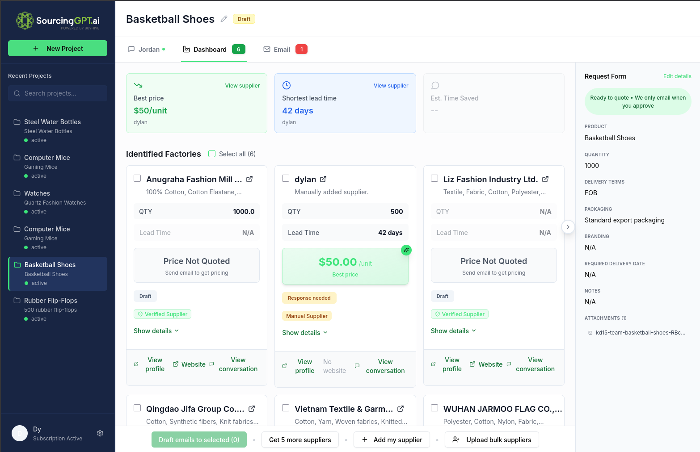
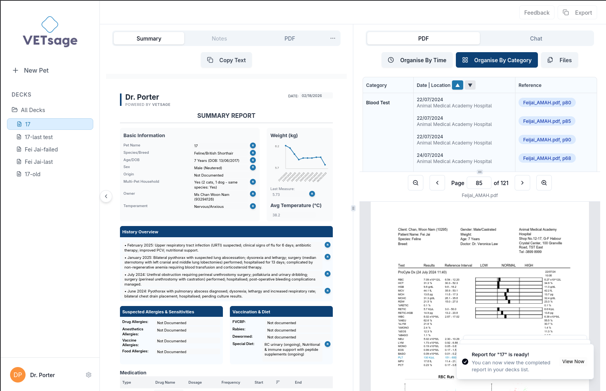

# Dylan Porter

**Full Stack & AI Dev · CS @ HKU**

Contract developer building production AI systems for startups across sourcing, healthcare, and EdTech.
I care about shipping things that actually work at scale.

---

### Where I work

**Full Stack AI Engineer** — [Collective Global](https://www.collectiveglobal.net/) 
End-to-end AI for startup clients: LLM pipelines, AWS infra, React/TypeScript frontends.

**Coding Instructor** — [BSD Education](https://bsd.education) 
Web dev, Python, AI, game dev · 100+ students aged 7–14.

*Previously: **IBM Z Student Ambassador** at HKU — spoke at IBM Z Day 2025 & LinuxONE Community Day 2025 (~1,000 attendees).*

### Products I've shipped through Collective

<table align="center">
<tr>
<td width="50%" valign="top" align="center">

  
<b><a href="https://sourcinggpt.ai">SourcingGPT</a></b> — agentic B2B supplier sourcing platform. Antler Inception SG20.
</td>
<td width="50%" valign="top" align="center">

  
<b><a href="https://vetsage.webflow.io/">VETsage</a></b> — RAG + OCR clinical report system, used by vet clinics internationally.
</td>
</tr>
</table>

### Stack

LLMs · Agentic AI · RAG · Python · TypeScript · AWS

---

[tdporter.dev](https://tdporter.dev) · [LinkedIn](https://linkedin.com/in/tdporter) · [X](https://x.com/tdporterdev) · [info@tdporter.dev](mailto:info@tdporter.dev)

